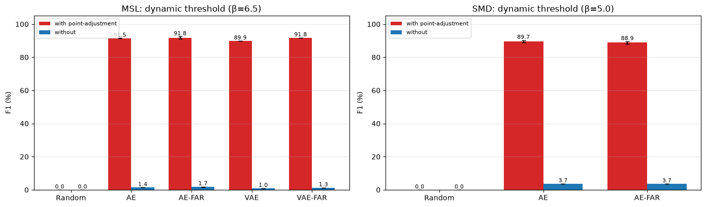
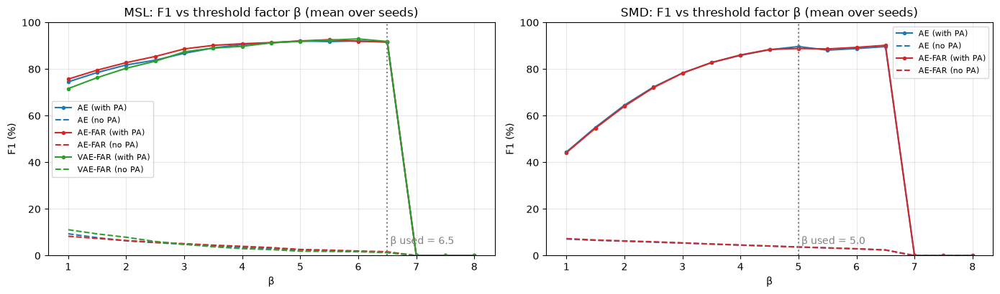
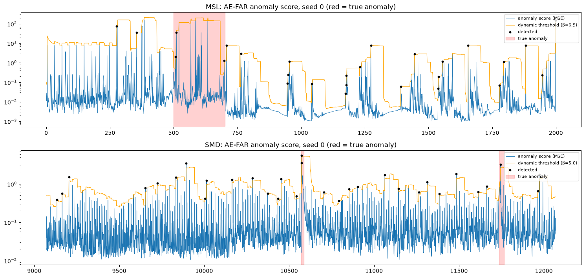

# AE-FAR Time-Series Anomaly Detection: Reproduction and Honest Evaluation

This repository reproduces [Time Series Anomaly Detection Leveraging MSE Feedback with AutoEncoder and RNN](https://drops.dagstuhl.de/entities/document/10.4230/LIPIcs.TIME.2024.17) (Delibasoglu and Heintz, TIME 2024), known as *AE-FAR*. It then evaluates the method more strictly than the paper does.

The working notebook is [`dl-proj4-aefar.ipynb`](dl-proj4-aefar.ipynb), saved with all outputs. It:

- checks the authors' pretrained models;
- retrains AE and AE-FAR with leak-free validation (3 seeds);
- compares the model with and without the MSE-feedback module;
- reports F1 **with and without point-adjustment**, a β-sensitivity sweep, and a random-score baseline.

Official paper code: [mribrahim/AE-FAR](https://github.com/mribrahim/AE-FAR), pinned to commit `794bb0b`. The notebook **clones it at run time**; it is not copied here.

Course project: CS/IT 433 — Topics in Deep Learning, Autumn 2026–27 (Project 4).

---

## Results

F1 (%) with the paper's dynamic threshold. For our runs: mean ± std over 3 seeds, except where noted.

| Model | MSL paper | MSL, with PA | MSL, no PA | SMD paper | SMD, with PA | SMD, no PA |
| --- | --- | --- | --- | --- | --- | --- |
| AE-FAR, **authors' pretrained weights** | 93.85 | **93.85** | 1.78 | 90.06 | 89.51 | 3.77 |
| AE alone (ours) | 91.83* | 91.53 ± 0.03 | 1.41 | 89.79* | 89.69 ± 0.59 | 3.73 |
| AE-FAR (ours) | 93.85 | 91.76 ± 0.72 | 1.67 | 90.06 | 88.86 ± 0.68 | 3.67 |
| VAE-FAR (ours, 1 seed) | 92.50 | 91.84 | 1.30 | — | — | — |
| Random scores, top-1% threshold | — | **89.41** | 1.84 | — | **82.56** | 1.70 |

\*Paper Table 1, "AE*" (AE + dynamic threshold). The other paper values are from Table 3. PA = point-adjustment.

**Findings:**

1. **The published MSL result reproduces exactly.** The authors' MSL model gives P 92.59, R 95.13, F1 93.85. For SMD, F1 is 0.55 lower, with a different precision/recall balance; we did not identify the cause.
2. **The MSE-feedback module gives no consistent gain** over the plain AE with the same threshold: +0.23 on MSL and −0.83 on SMD, both within the seed spread. Most of the performance comes from the dynamic threshold, which the paper's own Table 1 also suggests.
3. **Point-adjustment inflates F1.** Without it, F1 falls from about 90% to **under 4%**, and AUC-ROC is only 0.63 (MSL) and 0.72 (SMD). Random scores reach **89.4% (MSL) and 82.6% (SMD)** F1 with point-adjustment.
4. **β has a hard ceiling.** The current point is part of its own 50-step window, so `(s_t − mean) / std ≤ 49/√50 ≈ 6.93`. As a result, β = 6.5 fires only on near-isolated spikes (mostly anomaly onsets), and β ≥ 7 can never fire.





All headline numbers are in [`results/key_results.csv`](results/key_results.csv), transcribed from the notebook's printed outputs.

---

## Differences between the official code and the paper text

We documented these and kept the official behaviour, except for item 4.

1. **The "autoencoder" is a forecaster.** It maps a 50-step window to the **next** time step, rather than reconstructing the input (paper Eq. 1).
2. **The RNN has no memory across time.** It receives a sequence of length 1 with a zero initial state, so in practice it is a deep feed-forward network.
3. **The feedback MSE uses the answer.** It is computed with the **true value being scored**, so the "corrected" output already uses that value. It acts as a learned re-scoring of the error.
4. **Validation set = test set** in `read_data`, so early stopping used test data. **Changed here:** validation is the last 20% of the training series.
5. **β for SMD differs.** The paper text says 4; the code uses 5, which reproduces the published SMD row.

Inside the paper itself, AE-FAR's overall F1 is 93.38 in §1 but 93.59 in §4.3; the Table 3 average is 93.59.

---

## Setup (this run)

| Piece | Choice |
| --- | --- |
| Data | MSL (55 channels, 10.53% anomalous, 36 segments) and SMD (38 channels, 4.16% anomalous, 327 segments): standard preprocessed benchmarks from a CC BY 4.0 mirror |
| Model | Official base networks (`CustomModel`, `LSTM_VAE`); our implementation of the attention + MSE-feedback RNN (paper Eq. 2–4) |
| Training | Window 50, Adam lr 1e-4, batch 128, ≤ 100 epochs, early-stopping patience 10, two phases (base network, then the frozen base + feedback module) |
| Validation | Last 20% of the training series (leak-free) |
| Evaluation | Official dynamic threshold and point-adjustment, plus F1 without point-adjustment, AUC-ROC/PR, a β sweep, and random scores |
| Hardware | NVIDIA RTX 4060 Laptop GPU (8 GB), Python 3.14.6, PyTorch 2.13.0; total run time 3.11 h |

---

## How to run

1. Open `dl-proj4-aefar.ipynb` on Kaggle (GPU T4 ×2, Internet on) or on a local CUDA machine.
2. Run all cells. The notebook clones the official repo, downloads MSL and SMD, trains, evaluates, and writes `export/` and `aefar_p4_export.zip`.
3. Optional settings:
   - `DRY_RUN = True` runs a quick CPU smoke test on synthetic data.
   - `RESUME_FROM` resumes an interrupted run.
   - `RUN_TRAINING = False` runs only the evaluation.

The helper code is in [`src/`](src): `aefar_lib.py` (composite model, leak-free training, scoring) and `run_experiment.py` (per-dataset training runs). Both are also written out by the notebook itself.

## Repository layout

```text
dl-proj4-aefar.ipynb      notebook with all outputs
src/aefar_lib.py          composite model + training + scoring
src/run_experiment.py     training script (one dataset, several seeds)
results/key_results.csv   headline numbers
figures/                  data, training curves, β sweep, F1 bars, anomaly-score timeline
```

## Licence and attribution

The method and the base networks belong to the paper's authors. The official repository has no licence file, so its code is **not redistributed** here; the notebook clones it at run time. The three composite-model classes in `src/aefar_lib.py` keep the official class and attribute names, so that the authors' pretrained models can be loaded for verification. The paper is published under CC BY 4.0.

## Citation

```bibtex
@inproceedings{delibasoglu2024aefar,
  title     = {Time Series Anomaly Detection Leveraging MSE Feedback with AutoEncoder and RNN},
  author    = {Delibasoglu, Ibrahim and Heintz, Fredrik},
  booktitle = {31st International Symposium on Temporal Representation and Reasoning (TIME 2024)},
  series    = {LIPIcs},
  volume    = {318},
  pages     = {17:1--17:12},
  year      = {2024},
  doi       = {10.4230/LIPIcs.TIME.2024.17}
}
```
